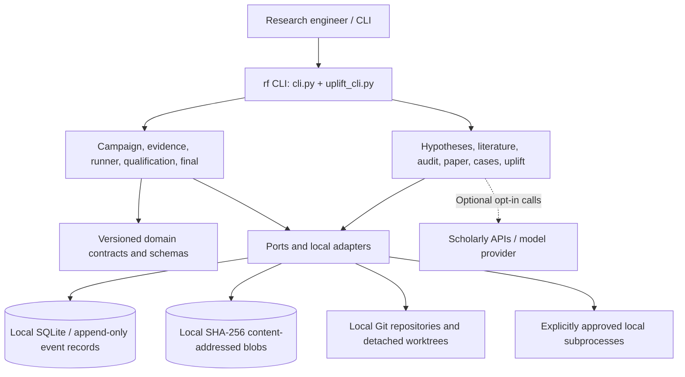

# ResearchForge architecture

ResearchForge is a local-first Python 3.12+ toolkit with a CLI and a modular
application core. The [implementation roadmap](roadmap.md) records its staged
development; this page describes the **current repository**, through merged PR14.

## Component map

The diagram shows logical responsibilities, **not** a sandbox or independently
secured service boundary. See actual package modules under `src/researchforge/`:

| Responsibility | Modules | Purpose |
| --- | --- | --- |
| Typed public contracts | `domain/`, `schemas/` | Validate envelopes, manifests and result structures |
| Experiment lifecycle | `application/campaigns.py`, `qualification.py`, `final.py` | Freeze a campaign; register and qualify candidates; seal the final comparison |
| Evidence and execution | `application/evidence.py`, `runner.py`, `adapters/cas.py`, `adapters/sqlite/` | Persist events and hashes; execute bounded trusted local evaluators |
| Research extensions | `hypothesis_forge.py`, `literature.py`, `audit.py`, `paper.py`, `statistics.py` | Draft/approve hypotheses, retrieve metadata, inspect typed evidence, export drafts and summaries |
| Demonstrations / studies | `demo.py`, `case_studies.py`, `networkx_case_demo.py`, `uplift.py` | Execute offline fixtures and record independently replayable case/paired-trial evidence |
| CLI and skills | `cli.py`, `uplift_cli.py`, `portable_skills.py` | Present supported commands and explicitly exported skills |

## Experiment evidence flow

1. Validate a local campaign manifest, source Git identity, evaluator source,
   metric policy, and disjoint input splits; freeze their hashes in a manifest lock.
2. Explicitly approve a trusted-local evaluator. Run it in a detached worktree,
   store bounded output and append start/terminal evidence events.
3. Register a hypothesis/candidate and independently replay the qualified
   evidence before accepting a selection-stage result. Failed, malformed or
   ambiguous attempts do not silently become successful measurements.
4. Nominate a candidate **before** final evaluation. A final start consumes
   the one-shot privilege, including an interrupted/unknown result.
5. Verify stored evidence and generate reports without re-running evaluators.
   The built-in `rf demo run --offline` exercises this chain end-to-end.

Literature retrieval requires `--allow-network`; optional model-generated
hypothesis drafts require `--allow-model-network` and operator credentials.
The independent PaperForge export reads already collected evidence and does
not itself call a provider. PR14 agent trials require
`--approve-trusted-agent` and are **not** proof that a model performs better.

## Boundaries and evidence limits

- **Security:** Local processes run with operator permissions. Environment
  allowlists and resource/output bounds reduce accidental exposure; they do
  not isolate malicious code or prevent every side effect.
- **Integrity:** Local CAS/event hashes support replay and detect ordinary
  mutation, but do not authenticate an administrator or prevent coordinated
  tampering of all local records. No remote trust anchor is implemented.
- **Research inference:** A frozen, aggregate final result supports only its
  declared comparison on the fixed data. It is not population-level
  superiority, peer review, a novelty finding, or proof of causal uplift.
- **Determinism:** Fixed inputs and explicit hashes improve reproducibility,
  but filesystem paths, timestamps, commits and external agents can vary.
- **Operations:** No deployed service, multi-tenant isolation, unattended
  release/publishing pipeline or commercially validated support promise
  is claimed. ResearchForge is proprietary under [LICENSE](../LICENSE).

For exact data contracts, commands and independently asserted invariants,
see [contracts](CONTRACTS.md), [MVP acceptance](MVP_ACCEPTANCE.md),
[agent evaluation](AGENT_UPLIFT.md), and [threat model](THREAT_MODEL.md).
